# Manual Técnico de la Aplicación — RMHD Ideas

**Gestión de producción microempresas artesanales colombianas y Plataforma de comercio electrónico con inteligencia artificial para gestionar pedidos, recomendar productos y automatizar la producción de microempresas artesanales colombianas**

**Caso de estudio:** RMHD Ideas
**Autora:** Abril Góngora, Hanna Katherine
**Universidad Manuela Beltrán — Ingeniería de Software**
Bogotá D.C., Colombia — 2026

---

## Introducción

Este manual técnico documenta los 12 componentes requeridos para la aprobación de Proyecto II: requerimientos funcionales y no funcionales, modelo relacional y script de la base de datos, actores y roles, casos de uso (alto nivel y extendidos), y los diagramas UML de clases, estados, colaboración, secuencia, componentes y distribución de la plataforma RMHD Ideas.

Todos los diagramas se modelaron en PlantUML; su código fuente completo está incluido más abajo y también vive en `docs/diagrams/` dentro de este repositorio, para que puedan regenerarse o modificarse.

## Índice

1. [Requerimientos funcionales](#componente-1-requerimientos-funcionales)
2. [Requerimientos no funcionales por tipo (12 tipos)](#componente-2-requerimientos-no-funcionales-por-tipo-12-tipos)
3. [Modelo relacional de la base de datos](#componente-3-modelo-relacional-de-la-base-de-datos)
4. [Script de generación de la base de datos](#componente-4-script-de-generación-de-la-base-de-datos)
5. [Definición de actores y roles](#componente-5-definición-de-actores-y-roles)
6. [Casos de uso](#componente-6-casos-de-uso)
7. [Diagrama de clases](#componente-7-diagrama-de-clases)
8. [Diagrama de estados x cada clase](#componente-8-diagrama-de-estados-por-cada-clase)
9. [Diagrama de colaboración x proceso](#componente-9-diagrama-de-colaboración-por-proceso)
10. [Diagrama de secuencia x proceso](#componente-10-diagrama-de-secuencia-por-proceso)
11. [Diagrama de componentes](#componente-11-diagrama-de-componentes)
12. [Diagrama de distribución](#componente-12-diagrama-de-distribución)

---

## Componente 1. Requerimientos funcionales

29 requerimientos funcionales organizados en 7 módulos, con la gestión de producción como eje central del proyecto.

### 1.1. Módulo de gestión de producción (eje central del proyecto)

| ID | Descripción del requerimiento | Prioridad | Criterio de aceptación |
|---|---|---|---|
| RF-01 | El sistema debe permitir registrar cada pedido confirmado como una orden de producción, con fecha de inicio, fecha estimada de entrega y estado (en cola, en proceso, en acabados, terminado, entregado). | Alta | Al confirmar un pedido, se crea automáticamente una orden de producción visible en el panel de la artesana con estado inicial "en cola". |
| RF-02 | El sistema debe permitir a la artesana definir el tiempo estimado de producción por producto o categoría de producto (p. ej. 3-5 días para elaboración de cajas, 10-15 días para elaboración ramos de flores artificiales). | Alta | La artesana puede editar el tiempo estimado de cada producto/categoría desde el panel administrativo y el cambio se refleja en los nuevos pedidos. |
| RF-03 | El sistema debe calcular y mostrar al cliente una fecha estimada de entrega basada en el tiempo de producción real del producto y la carga actual de pedidos en cola. | Alta | Al finalizar la compra, el cliente visualiza una fecha estimada de entrega calculada automáticamente, no una fecha fija genérica. |
| RF-04 | El sistema debe permitir a la artesana actualizar manualmente el estado de una orden de producción en cualquier momento del proceso. | Alta | La artesana puede cambiar el estado de una orden desde una vista de tablero (kanban) y el cambio se guarda con fecha y hora. |
| RF-05 | El sistema debe notificar automáticamente al cliente cuando el estado de su orden de producción cambia (confirmado, en producción, en acabados, listo para envío). | Alta | El cliente recibe una notificación (correo o WhatsApp vía n8n) dentro de los 5 minutos posteriores al cambio de estado. |
| RF-06 | El sistema debe mostrar a la artesana un panel consolidado con la carga de producción actual: número de órdenes por estado, órdenes próximas a vencer su fecha estimada y órdenes atrasadas. | Alta | El panel muestra en tiempo real los conteos por estado y resalta en rojo las órdenes cuya fecha estimada está vencida o a menos de 2 días. |
| RF-07 | El sistema debe permitir registrar el consumo estimado o real de materiales/insumos por orden de producción (opcional, según lo defina la artesana). | Media | La artesana puede asociar una lista de materiales a un producto y el sistema resta o registra su uso al iniciar la orden. |
| RF-08 | El sistema debe permitir priorizar manualmente el orden de producción de las órdenes en cola (por ejemplo, adelantar un pedido urgente). | Media | La artesana puede reordenar las órdenes en cola arrastrándolas en el tablero y el nuevo orden se conserva al recargar la vista. |
| RF-09 | El sistema debe generar alertas proactivas de producción cuando el módulo de predicción de demanda anticipe un incremento de pedidos por encima de un umbral definido, indicando la fecha aproximada y la categoría de producto afectada. | Alta | Cuando el modelo de predicción supera el umbral configurado, se envía una alerta automática a la artesana (vía n8n) con al menos 5 días de anticipación. |
| RF-10 | El sistema debe permitir a la artesana consultar un historial de órdenes de producción completadas, filtrable por rango de fechas y categoría de producto. | Media | La artesana puede filtrar el historial y exportar o visualizar el tiempo real promedio de producción por categoría. |
| RF-11 | El sistema debe calcular y mostrar el tiempo real de producción (desde inicio hasta entrega) de cada orden completada, para comparación con el tiempo estimado. | Media | Cada orden completada muestra el tiempo estimado vs. el tiempo real, con la diferencia en días. |
| RF-12 | El sistema debe permitir a la artesana definir su capacidad de producción (por ejemplo, número máximo de órdenes simultáneas o por semana) y advertir cuando la cola de pedidos supera esa capacidad. | Alta | Al superar la capacidad configurada, el sistema muestra una advertencia visible en el panel antes de aceptar nuevos pedidos que comprometan el tiempo estimado de entrega. |
| RF-13 | El sistema debe presentar una vista de planificación general de la producción (más allá de una orden individual) que permita a la artesana anticipar su carga de trabajo por semana o mes. | Media | La artesana puede visualizar, en una sola vista, todas las órdenes agrupadas por semana o mes según su fecha estimada de entrega. |

### 1.2. Módulo de pre-órdenes y gestión de pedidos

| ID | Descripción del requerimiento | Prioridad | Criterio de aceptación |
|---|---|---|---|
| RF-14 | El sistema debe permitir al cliente realizar un pedido bajo modalidad de pre-orden cuando el producto no tiene stock inmediato, indicando claramente que se trata de producción bajo demanda. | Alta | El cliente confirma explícitamente que acepta el modelo de pre-orden antes de finalizar la compra. |
| RF-15 | El sistema debe permitir a la artesana consultar el listado completo de pedidos con su información de cliente, productos, estado y fecha estimada. | Alta | La artesana accede a un listado filtrable y buscable de todos los pedidos activos e históricos. |
| RF-16 | El sistema debe generar automáticamente una confirmación de pedido con los datos de la compra al cliente inmediatamente después del pago. | Alta | El cliente recibe la confirmación en menos de 2 minutos tras el pago exitoso. |

### 1.3. Módulo de recomendación con inteligencia artificial

| ID | Descripción del requerimiento | Prioridad | Criterio de aceptación |
|---|---|---|---|
| RF-17 | El sistema debe recomendar productos personalizados al cliente con base en su historial de navegación e interacciones dentro de la tienda. | Alta | El cliente ve una sección de "recomendados para ti" que cambia según los productos que ha visto o comprado. |
| RF-18 | El sistema debe aplicar un enfoque de filtrado basado en contenido para nuevos clientes sin historial (mitigación del problema de arranque en frío). | Alta | Un cliente nuevo, sin historial, recibe recomendaciones basadas en atributos del producto (categoría, materiales, estilo) desde su primera visita. |
| RF-19 | El sistema debe permitir a la artesana revisar y, si lo considera necesario, destacar u ocultar manualmente productos de las recomendaciones automáticas. | Media | La artesana puede marcar un producto como "destacado" o "no recomendar" desde el panel administrativo. |

### 1.4. Módulo de automatización de comunicaciones y producción

| ID | Descripción del requerimiento | Prioridad | Criterio de aceptación |
|---|---|---|---|
| RF-20 | El sistema debe automatizar el envío de notificaciones al cliente en los puntos clave del proceso (confirmación de pedido, cambio de estado de producción, envío) mediante una plataforma de automatización de flujos (n8n). | Alta | Las notificaciones se disparan automáticamente sin intervención manual de la artesana en al menos el 90% de los casos. |
| RF-21 | El sistema debe permitir configurar plantillas de mensajes reutilizables para las comunicaciones automatizadas. | Media | La artesana puede editar el texto de las plantillas sin necesidad de modificar el flujo de automatización. |

### 1.5. Módulo de predicción de demanda estacional

| ID | Descripción del requerimiento | Prioridad | Criterio de aceptación |
|---|---|---|---|
| RF-22 | El sistema debe entrenar y ejecutar un modelo de predicción de demanda (Prophet) con base en el historial de pedidos, considerando estacionalidades del sector artesanal colombiano (Navidad, Día de la Madre, ferias). | Alta | El modelo genera una proyección de demanda por categoría de producto para al menos los siguientes 30 días. |
| RF-23 | El sistema debe mostrar un panel de visualización de las proyecciones de demanda a la artesana. | Media | La artesana visualiza una gráfica de demanda proyectada vs. histórica, actualizada periódicamente. |

### 1.6. Módulo de catálogo y tienda en línea

| ID | Descripción del requerimiento | Prioridad | Criterio de aceptación |
|---|---|---|---|
| RF-24 | El sistema debe permitir a la artesana crear, editar y eliminar productos del catálogo con nombre, descripción, categoría, precio, fotos y disponibilidad (bajo pedido / stock limitado). | Alta | La artesana gestiona el catálogo completo sin intervención técnica y los cambios se reflejan en la tienda en menos de 1 minuto. |
| RF-25 | El sistema debe permitir al cliente navegar el catálogo, filtrar por categoría y visualizar el detalle de cada producto incluyendo el tiempo estimado de producción. | Alta | El cliente puede filtrar productos por categoría y ver el tiempo estimado de entrega antes de comprar. |
| RF-26 | El sistema debe contar con un carrito de compras que permita agregar, modificar cantidades y eliminar productos antes de confirmar el pedido. | Alta | El cliente completa un flujo de compra de principio a fin sin errores en cantidades o totales. |
| RF-27 | El sistema debe integrarse con una pasarela de pago (Wompi/PSE) para procesar pagos en línea de forma segura. | Alta | El cliente completa un pago de prueba y el pedido se marca como "pagado" solo tras la confirmación de la pasarela. |

### 1.7. Panel administrativo y autenticación

| ID | Descripción del requerimiento | Prioridad | Criterio de aceptación |
|---|---|---|---|
| RF-28 | El sistema debe contar con autenticación segura y diferenciada para el perfil de artesana administradora y el perfil de cliente. | Alta | Cada perfil accede únicamente a las funcionalidades correspondientes a su rol. |
| RF-29 | El sistema debe permitir a la artesana visualizar métricas básicas de operación: número de pedidos, ingresos estimados y productos más vendidos en un periodo determinado. | Media | El panel muestra un resumen de métricas filtrable por rango de fechas. |

---

## Componente 2. Requerimientos no funcionales por tipo (12 tipos)

Los 15 requerimientos no funcionales se clasifican en 12 tipos (categorías de calidad):

1. Usabilidad · 2. Rendimiento · 3. Disponibilidad · 4. Escalabilidad · 5. Seguridad · 6. Protección de datos · 7. Confiabilidad · 8. Mantenibilidad · 9. Compatibilidad · 10. Interoperabilidad · 11. Legal · 12. Trazabilidad

| ID | Tipo (categoría) | Descripción del requerimiento |
|---|---|---|
| RNF-01 | Usabilidad | La interfaz del panel de gestión de producción debe ser utilizable por una persona sin formación técnica avanzada (perfil de la artesana, mayor de 40 años), priorizando simplicidad visual y retroalimentación inmediata sobre el estado de las órdenes. |
| RNF-02 | Usabilidad | La plataforma debe alcanzar un puntaje mínimo de 68 puntos en el cuestionario System Usability Scale (SUS) durante las pruebas de usabilidad. |
| RNF-03 | Rendimiento | El panel de gestión de producción debe cargar y reflejar cambios de estado de las órdenes en un tiempo menor a 3 segundos bajo condiciones normales de uso. |
| RNF-04 | Rendimiento | El sistema de recomendación debe generar sugerencias de productos en un tiempo menor a 2 segundos por solicitud. |
| RNF-05 | Disponibilidad | La plataforma debe mantener una disponibilidad mínima del 95% mensual, considerando que la gestión de producción y pedidos es una operación crítica del negocio. |
| RNF-06 | Escalabilidad | La arquitectura debe soportar el crecimiento del catálogo y del volumen de órdenes de producción sin degradar el rendimiento, dentro de los límites de infraestructura definidos para el proyecto (Railway.app). |
| RNF-07 | Seguridad | El sistema debe cifrar en tránsito todas las comunicaciones mediante TLS y aplicar hashing seguro a las contraseñas de los usuarios. |
| RNF-08 | Seguridad | El sistema debe implementar autenticación diferenciada por rol, restringiendo el acceso al panel de gestión de producción únicamente al perfil de artesana administradora. |
| RNF-09 | Protección de datos | El tratamiento de datos personales de clientes (nombre, contacto, historial de compras) debe cumplir con la Ley 1581 de 2012 y su decreto reglamentario 1377 de 2013, incluyendo autorización previa, expresa e informada. |
| RNF-10 | Confiabilidad | El estado de una orden de producción no debe perderse ni corromperse ante fallos del sistema; todo cambio de estado debe quedar persistido de forma transaccional. |
| RNF-11 | Mantenibilidad | El código del módulo de gestión de producción debe estar documentado y modularizado de forma que permita agregar nuevos estados de producción o categorías de producto sin reescribir el sistema. |
| RNF-12 | Compatibilidad | La plataforma debe funcionar correctamente en los navegadores más utilizados (Chrome, Safari, Edge) y ser responsiva para uso desde dispositivos móviles, considerando que la artesana puede gestionar producción desde su celular. |
| RNF-13 | Interoperabilidad | El módulo de automatización de comunicaciones debe integrarse con la plataforma de automatización de flujos (n8n) mediante API sin requerir programación adicional para nuevas notificaciones. |
| RNF-14 | Legal | El sistema debe cumplir con la Ley 527 de 1999 (validez jurídica de mensajes de datos) y la Ley 1480 de 2011 (Estatuto del Consumidor), incluyendo la excepción de derecho de retracto para bienes personalizados bajo pedido. |
| RNF-15 | Trazabilidad | Cada cambio de estado en una orden de producción debe quedar registrado con fecha, hora y usuario responsable, para permitir auditoría del proceso. |

---

## Componente 3. Modelo relacional de la base de datos

El modelo relacional traduce los requerimientos del módulo de gestión de producción, pedidos, recomendación, predicción de demanda y automatización de comunicaciones en **17 tablas** sobre PostgreSQL. La tabla `orden_produccion` es el núcleo del sistema: cada `detalle_pedido` genera exactamente una orden de producción con estado, fechas y trazabilidad (`historial_estado_orden`).

Código fuente: [`docs/diagrams/03_modelo_relacional.puml`](docs/diagrams/03_modelo_relacional.puml) — renderizado: [`docs/diagrams/png/03_modelo_relacional.png`](docs/diagrams/png/03_modelo_relacional.png)

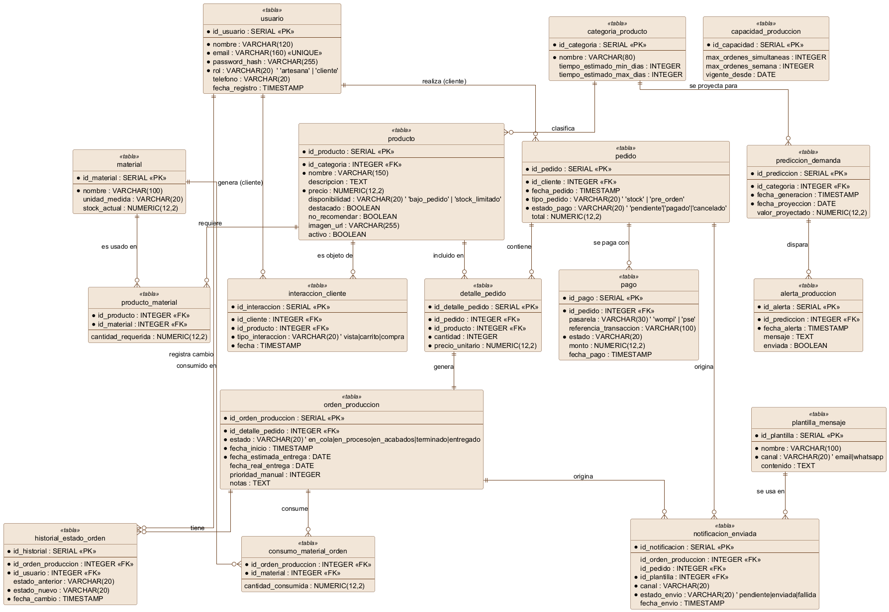

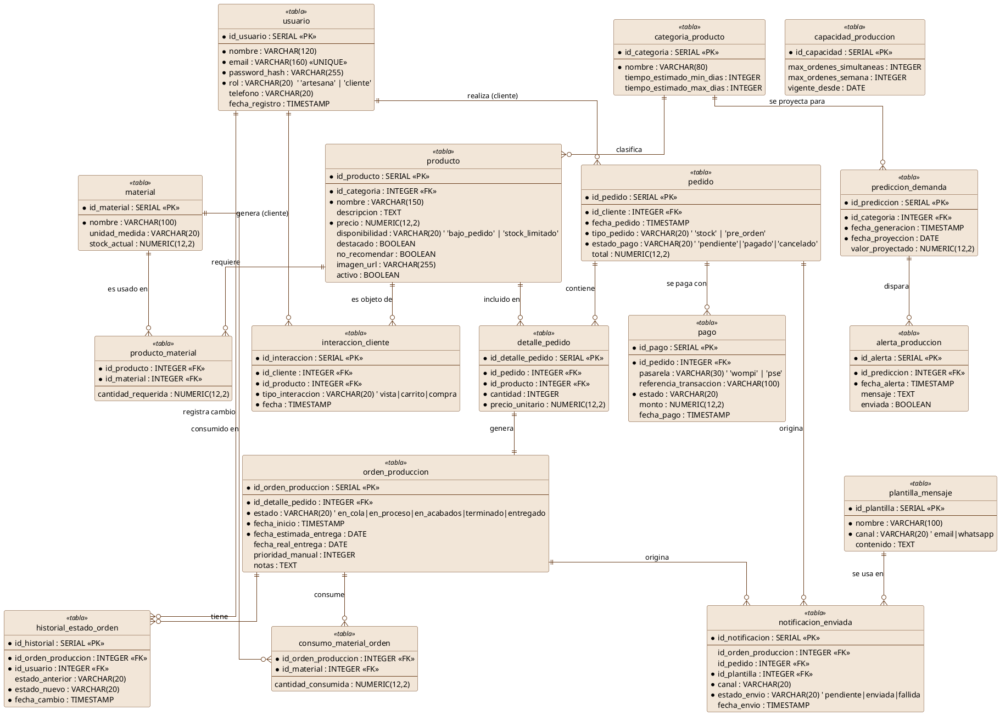

---

## Componente 4. Script de generación de la base de datos

Script DDL en PostgreSQL 14+, validado ejecutándolo contra una instancia real de PostgreSQL 16 (17 tablas creadas sin errores). Archivo completo: [`docs/database/script_bd_rmhd_ideas.sql`](docs/database/script_bd_rmhd_ideas.sql)

```sql
-- =====================================================================
-- Script de generación de la base de datos — Plataforma RMHD Ideas
-- Motor: PostgreSQL 14+
-- Componente 4 del Manual Técnico (corresponde al modelo relacional
-- del Componente 3 — ver docs/diagrams/03_modelo_relacional)
-- =====================================================================

BEGIN;

-- ---------------------------------------------------------------------
-- 1. Usuarios (artesana administradora y clientes)
-- ---------------------------------------------------------------------
CREATE TABLE usuario (
    id_usuario       SERIAL PRIMARY KEY,
    nombre           VARCHAR(120) NOT NULL,
    email            VARCHAR(160) NOT NULL UNIQUE,
    password_hash    VARCHAR(255) NOT NULL,
    rol              VARCHAR(20)  NOT NULL CHECK (rol IN ('artesana', 'cliente')),
    telefono         VARCHAR(20),
    fecha_registro   TIMESTAMP NOT NULL DEFAULT NOW()
);

-- ---------------------------------------------------------------------
-- 2. Catálogo: categorías, productos y materiales
-- ---------------------------------------------------------------------
CREATE TABLE categoria_producto (
    id_categoria              SERIAL PRIMARY KEY,
    nombre                    VARCHAR(80) NOT NULL,
    tiempo_estimado_min_dias  INTEGER,
    tiempo_estimado_max_dias  INTEGER
);

CREATE TABLE producto (
    id_producto      SERIAL PRIMARY KEY,
    id_categoria     INTEGER NOT NULL REFERENCES categoria_producto(id_categoria),
    nombre           VARCHAR(150) NOT NULL,
    descripcion      TEXT,
    precio           NUMERIC(12,2) NOT NULL CHECK (precio >= 0),
    disponibilidad   VARCHAR(20) NOT NULL DEFAULT 'bajo_pedido'
                     CHECK (disponibilidad IN ('bajo_pedido', 'stock_limitado')),
    destacado        BOOLEAN NOT NULL DEFAULT FALSE,
    no_recomendar    BOOLEAN NOT NULL DEFAULT FALSE,
    imagen_url       VARCHAR(255),
    activo           BOOLEAN NOT NULL DEFAULT TRUE
);

CREATE TABLE material (
    id_material      SERIAL PRIMARY KEY,
    nombre           VARCHAR(100) NOT NULL,
    unidad_medida    VARCHAR(20),
    stock_actual     NUMERIC(12,2) DEFAULT 0
);

CREATE TABLE producto_material (
    id_producto          INTEGER NOT NULL REFERENCES producto(id_producto) ON DELETE CASCADE,
    id_material          INTEGER NOT NULL REFERENCES material(id_material) ON DELETE CASCADE,
    cantidad_requerida   NUMERIC(12,2) NOT NULL DEFAULT 0,
    PRIMARY KEY (id_producto, id_material)
);

-- ---------------------------------------------------------------------
-- 3. Capacidad de producción (RF-12)
-- ---------------------------------------------------------------------
CREATE TABLE capacidad_produccion (
    id_capacidad             SERIAL PRIMARY KEY,
    max_ordenes_simultaneas  INTEGER NOT NULL,
    max_ordenes_semana       INTEGER NOT NULL,
    vigente_desde            DATE NOT NULL DEFAULT CURRENT_DATE
);

-- ---------------------------------------------------------------------
-- 4. Pedidos, detalle y pagos
-- ---------------------------------------------------------------------
CREATE TABLE pedido (
    id_pedido        SERIAL PRIMARY KEY,
    id_cliente       INTEGER NOT NULL REFERENCES usuario(id_usuario),
    fecha_pedido     TIMESTAMP NOT NULL DEFAULT NOW(),
    tipo_pedido      VARCHAR(20) NOT NULL CHECK (tipo_pedido IN ('stock', 'pre_orden')),
    estado_pago      VARCHAR(20) NOT NULL DEFAULT 'pendiente'
                     CHECK (estado_pago IN ('pendiente', 'pagado', 'cancelado')),
    total            NUMERIC(12,2) DEFAULT 0
);

CREATE TABLE detalle_pedido (
    id_detalle_pedido   SERIAL PRIMARY KEY,
    id_pedido           INTEGER NOT NULL REFERENCES pedido(id_pedido) ON DELETE CASCADE,
    id_producto         INTEGER NOT NULL REFERENCES producto(id_producto),
    cantidad            INTEGER NOT NULL CHECK (cantidad > 0),
    precio_unitario     NUMERIC(12,2) NOT NULL
);

CREATE TABLE pago (
    id_pago                 SERIAL PRIMARY KEY,
    id_pedido               INTEGER NOT NULL REFERENCES pedido(id_pedido) ON DELETE CASCADE,
    pasarela                VARCHAR(30) CHECK (pasarela IN ('wompi', 'pse')),
    referencia_transaccion  VARCHAR(100),
    estado                  VARCHAR(20) NOT NULL DEFAULT 'pendiente',
    monto                   NUMERIC(12,2),
    fecha_pago              TIMESTAMP
);

-- ---------------------------------------------------------------------
-- 5. Gestión de producción (núcleo del sistema)
-- ---------------------------------------------------------------------
CREATE TABLE orden_produccion (
    id_orden_produccion     SERIAL PRIMARY KEY,
    id_detalle_pedido       INTEGER NOT NULL UNIQUE
                            REFERENCES detalle_pedido(id_detalle_pedido) ON DELETE CASCADE,
    estado                  VARCHAR(20) NOT NULL DEFAULT 'en_cola'
                            CHECK (estado IN ('en_cola', 'en_proceso', 'en_acabados',
                                               'terminado', 'entregado')),
    fecha_inicio             TIMESTAMP NOT NULL DEFAULT NOW(),
    fecha_estimada_entrega   DATE NOT NULL,
    fecha_real_entrega       DATE,
    prioridad_manual         INTEGER DEFAULT 0,
    notas                    TEXT
);

CREATE TABLE historial_estado_orden (
    id_historial            SERIAL PRIMARY KEY,
    id_orden_produccion     INTEGER NOT NULL REFERENCES orden_produccion(id_orden_produccion) ON DELETE CASCADE,
    id_usuario              INTEGER NOT NULL REFERENCES usuario(id_usuario),
    estado_anterior         VARCHAR(20),
    estado_nuevo            VARCHAR(20) NOT NULL,
    fecha_cambio            TIMESTAMP NOT NULL DEFAULT NOW()
);

CREATE TABLE consumo_material_orden (
    id_orden_produccion     INTEGER NOT NULL REFERENCES orden_produccion(id_orden_produccion) ON DELETE CASCADE,
    id_material             INTEGER NOT NULL REFERENCES material(id_material),
    cantidad_consumida      NUMERIC(12,2) NOT NULL DEFAULT 0,
    PRIMARY KEY (id_orden_produccion, id_material)
);

-- ---------------------------------------------------------------------
-- 6. Recomendación (interacciones de cliente)
-- ---------------------------------------------------------------------
CREATE TABLE interaccion_cliente (
    id_interaccion       SERIAL PRIMARY KEY,
    id_cliente           INTEGER NOT NULL REFERENCES usuario(id_usuario),
    id_producto          INTEGER NOT NULL REFERENCES producto(id_producto),
    tipo_interaccion     VARCHAR(20) NOT NULL CHECK (tipo_interaccion IN ('vista', 'carrito', 'compra')),
    fecha                TIMESTAMP NOT NULL DEFAULT NOW()
);

-- ---------------------------------------------------------------------
-- 7. Predicción de demanda y alertas proactivas
-- ---------------------------------------------------------------------
CREATE TABLE prediccion_demanda (
    id_prediccion        SERIAL PRIMARY KEY,
    id_categoria         INTEGER NOT NULL REFERENCES categoria_producto(id_categoria),
    fecha_generacion     TIMESTAMP NOT NULL DEFAULT NOW(),
    fecha_proyeccion     DATE NOT NULL,
    valor_proyectado     NUMERIC(12,2)
);

CREATE TABLE alerta_produccion (
    id_alerta            SERIAL PRIMARY KEY,
    id_prediccion        INTEGER NOT NULL REFERENCES prediccion_demanda(id_prediccion) ON DELETE CASCADE,
    fecha_alerta         TIMESTAMP NOT NULL DEFAULT NOW(),
    mensaje              TEXT,
    enviada              BOOLEAN NOT NULL DEFAULT FALSE
);

-- ---------------------------------------------------------------------
-- 8. Automatización de comunicaciones
-- ---------------------------------------------------------------------
CREATE TABLE plantilla_mensaje (
    id_plantilla     SERIAL PRIMARY KEY,
    nombre           VARCHAR(100) NOT NULL,
    canal            VARCHAR(20) NOT NULL CHECK (canal IN ('email', 'whatsapp')),
    contenido        TEXT NOT NULL
);

CREATE TABLE notificacion_enviada (
    id_notificacion      SERIAL PRIMARY KEY,
    id_orden_produccion  INTEGER REFERENCES orden_produccion(id_orden_produccion) ON DELETE SET NULL,
    id_pedido            INTEGER REFERENCES pedido(id_pedido) ON DELETE SET NULL,
    id_plantilla         INTEGER NOT NULL REFERENCES plantilla_mensaje(id_plantilla),
    canal                VARCHAR(20) NOT NULL,
    estado_envio         VARCHAR(20) NOT NULL DEFAULT 'pendiente'
                         CHECK (estado_envio IN ('pendiente', 'enviada', 'fallida')),
    fecha_envio          TIMESTAMP
);

-- =====================================================================
-- Índices de soporte para las consultas más frecuentes
-- =====================================================================
CREATE INDEX idx_producto_categoria        ON producto(id_categoria);
CREATE INDEX idx_pedido_cliente            ON pedido(id_cliente);
CREATE INDEX idx_detalle_pedido_pedido     ON detalle_pedido(id_pedido);
CREATE INDEX idx_orden_estado              ON orden_produccion(estado);
CREATE INDEX idx_orden_fecha_estimada      ON orden_produccion(fecha_estimada_entrega);
CREATE INDEX idx_historial_orden           ON historial_estado_orden(id_orden_produccion);
CREATE INDEX idx_interaccion_cliente       ON interaccion_cliente(id_cliente);
CREATE INDEX idx_interaccion_producto      ON interaccion_cliente(id_producto);
CREATE INDEX idx_prediccion_categoria      ON prediccion_demanda(id_categoria);
CREATE INDEX idx_notificacion_estado       ON notificacion_enviada(estado_envio);

-- =====================================================================
-- Datos semilla mínimos (configuración inicial)
-- =====================================================================
INSERT INTO capacidad_produccion (max_ordenes_simultaneas, max_ordenes_semana)
VALUES (8, 15);

INSERT INTO categoria_producto (nombre, tiempo_estimado_min_dias, tiempo_estimado_max_dias)
VALUES
    ('Cajas artesanales', 3, 5),
    ('Ramos de flores artificiales', 10, 15);

COMMIT;
```

---

## Componente 5. Definición de actores y roles

### 5.1. Actores del sistema

| Actor | Tipo | Descripción |
|---|---|---|
| Artesana administradora | Humano (primario) | Propietaria de RMHD Ideas. Gestiona catálogo, producción, pedidos, recomendaciones destacadas/ocultas, plantillas de comunicación y métricas. Única usuaria con rol `artesana`. |
| Cliente | Humano (primario) | Navega el catálogo, realiza pedidos o pre-órdenes, paga en línea y recibe notificaciones. Usuaria/o con rol `cliente`. |
| Pasarela de pago (Wompi/PSE) | Sistema externo | Procesa transacciones de pago y notifica su resultado (aprobado/rechazado) a la plataforma. |
| Plataforma de automatización (n8n) | Sistema externo | Orquesta el envío de notificaciones (correo/WhatsApp) y dispara flujos a partir de eventos del sistema (cambios de estado, alertas de producción). |
| Motor de IA (recomendación y predicción) | Sistema externo / módulo interno | Genera recomendaciones personalizadas de productos (filtrado basado en contenido) y proyecciones de demanda (modelo Prophet). |
| WhatsApp Business API (Meta) | Sistema externo | Canal de entrega de notificaciones hacia clientes y hacia la artesana. |

### 5.2. Roles y permisos

| Rol | Permisos |
|---|---|
| Artesana administradora | CRUD de catálogo (productos, categorías, materiales); gestión completa del tablero de producción (cambiar estado, priorizar, consultar historial); configuración de capacidad de producción y tiempos estimados; configuración de plantillas de mensajes; gestión de destacados/ocultos de recomendación; visualización de métricas y del panel de predicción de demanda. No tiene acceso a datos de pago de otros negocios ni a configuración de infraestructura. |
| Cliente | Navegación y filtrado de catálogo; gestión de su propio carrito; creación de pedidos y pre-órdenes; pago en línea; consulta del estado de sus propios pedidos; recepción de notificaciones; visualización de recomendaciones personalizadas. No tiene acceso al panel administrativo ni a datos de otros clientes. |

---

## Componente 6. Casos de uso

### 6.a. Casos de uso de alto nivel

Código fuente: [`docs/diagrams/06a_casos_uso_alto_nivel.puml`](docs/diagrams/06a_casos_uso_alto_nivel.puml)

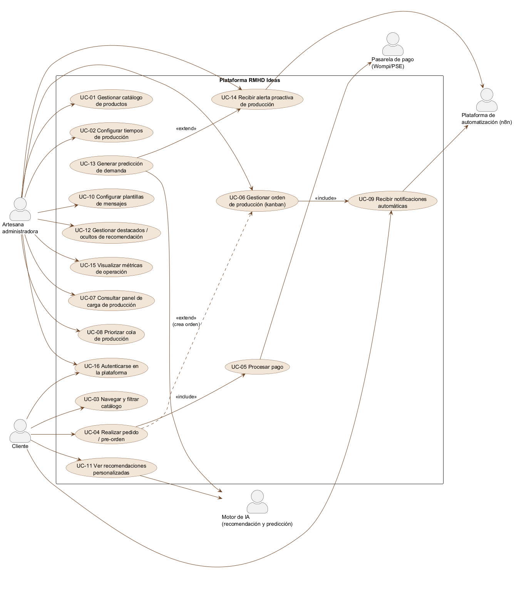

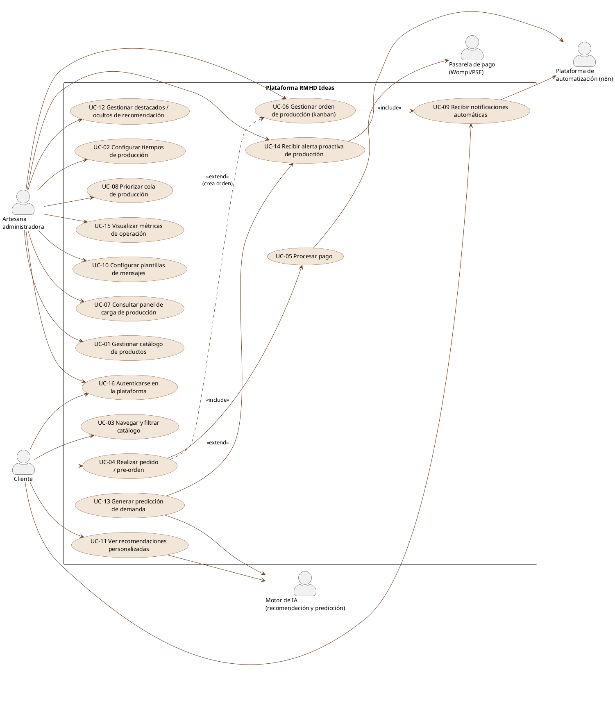

| ID | Nombre | Actor(es) principal(es) |
|---|---|---|
| UC-01 | Gestionar catálogo de productos | Artesana |
| UC-02 | Configurar tiempos de producción | Artesana |
| UC-03 | Navegar y filtrar catálogo | Cliente |
| UC-04 | Realizar pedido / pre-orden | Cliente |
| UC-05 | Procesar pago | Cliente, Pasarela de pago |
| UC-06 | Gestionar orden de producción (kanban) | Artesana |
| UC-07 | Consultar panel de carga de producción | Artesana |
| UC-08 | Priorizar cola de producción | Artesana |
| UC-09 | Recibir notificaciones automáticas | Cliente, n8n |
| UC-10 | Configurar plantillas de mensajes | Artesana |
| UC-11 | Ver recomendaciones personalizadas | Cliente, Motor de IA |
| UC-12 | Gestionar destacados/ocultos de recomendación | Artesana |
| UC-13 | Generar predicción de demanda | Motor de IA |
| UC-14 | Recibir alerta proactiva de producción | Artesana, n8n |
| UC-15 | Visualizar métricas de operación | Artesana |
| UC-16 | Autenticarse en la plataforma | Artesana, Cliente |

### 6.b. Casos de uso extendidos

#### UC-04 — Realizar pedido / pre-orden

- **Actor principal:** Cliente
- **Actores secundarios:** Pasarela de pago (Wompi/PSE)
- **Precondición:** El cliente está autenticado y tiene al menos un producto en el carrito.
- **Postcondición:** El pedido queda registrado con estado de pago `pagado` y se genera automáticamente una orden de producción (UC-06).

**Flujo básico:**

1. El cliente revisa su carrito y selecciona "Confirmar pedido".
2. El sistema indica si alguno de los productos requiere modalidad de pre-orden (producción bajo demanda) y solicita confirmación explícita (RF-14).
3. El cliente acepta las condiciones de pre-orden.
4. El sistema calcula el total y redirige a la pasarela de pago.
5. El cliente completa el pago.
6. La pasarela notifica el resultado a la plataforma.
7. El sistema registra el pedido como `pagado`, genera la(s) orden(es) de producción correspondientes y envía confirmación al cliente.

**Flujos alternos:**

- 3a. El cliente no acepta las condiciones de pre-orden → el sistema cancela la operación y regresa al carrito.

**Excepciones:**

- 6a. La pasarela rechaza el pago → el pedido queda en estado `cancelado` y se notifica el error al cliente sin generar orden de producción.
- 6b. Tiempo de espera agotado sin respuesta de la pasarela → el pedido se marca `cancelado` tras el tiempo límite configurado.

#### UC-06 — Gestionar orden de producción (kanban)

- **Actor principal:** Artesana administradora
- **Precondición:** Existe al menos una orden de producción en estado distinto de `entregado`.
- **Postcondición:** El estado de la orden se actualiza, queda registrado en el historial (trazabilidad) y se notifica al cliente.

**Flujo básico:**

1. La artesana abre el tablero de producción (vista kanban por estado).
2. Selecciona una orden y elige el nuevo estado (en cola → en proceso → en acabados → terminado → entregado).
3. El sistema valida que la transición de estado sea válida.
4. El sistema registra el cambio en el historial de estados con usuario y fecha/hora.
5. El sistema dispara una notificación automática al cliente mediante n8n.

**Flujos alternos:**

- 2a. La artesana reordena manualmente la prioridad de una orden en cola (UC-08) sin cambiar su estado.

**Excepciones:**

- 3a. La transición solicitada no es válida (p. ej., de "en cola" a "entregado" sin pasos intermedios) → el sistema rechaza el cambio y muestra un mensaje de validación.

#### UC-09 — Recibir notificaciones automáticas

- **Actor principal:** Cliente (también aplica a la Artesana para alertas de producción)
- **Actor secundario:** n8n
- **Precondición:** Ocurre un evento disparador (cambio de estado de orden, confirmación de pedido, alerta de predicción de demanda).
- **Postcondición:** La notificación queda registrada con estado `enviada` o `fallida`.

**Flujo básico:**

1. El sistema detecta un evento disparador y selecciona la plantilla de mensaje correspondiente al canal configurado (correo o WhatsApp).
2. El sistema envía el evento a n8n con los datos necesarios para renderizar la plantilla.
3. n8n envía el mensaje por el canal configurado.
4. n8n confirma el envío exitoso a la plataforma.
5. El sistema actualiza el registro de notificación a `enviada`.

**Excepciones:**

- 3a. Falla el canal de envío (WhatsApp/correo) → la notificación pasa a estado `fallida` y n8n reintenta según su política configurada.
- 3b. Reintentos agotados → la notificación queda `fallida` de forma definitiva y se registra la incidencia para revisión de la artesana.

#### UC-11 — Ver recomendaciones personalizadas

- **Actor principal:** Cliente
- **Actor secundario:** Motor de IA
- **Precondición:** El cliente está navegando el catálogo o la página de un producto.
- **Postcondición:** Se muestra una lista de productos recomendados.

**Flujo básico:**

1. El cliente ingresa a la tienda o visualiza un producto.
2. El sistema solicita recomendaciones al motor de IA, enviando el historial de interacciones del cliente (si existe).
3. El motor de IA aplica filtrado basado en contenido (o colaborativo/híbrido cuando hay suficientes interacciones) y devuelve una lista de productos.
4. El sistema excluye productos marcados como "no recomendar" por la artesana (UC-12) y prioriza los marcados como "destacados".
5. El sistema muestra la sección "recomendados para ti".

**Flujos alternos:**

- 2a. El cliente no tiene historial de interacciones (arranque en frío) → el motor de IA aplica únicamente filtrado basado en contenido con base en atributos del producto.

#### UC-13 — Generar predicción de demanda

- **Actor principal:** Motor de IA (modelo Prophet)
- **Actor secundario:** n8n (disparador programado), Artesana (receptora de alertas)
- **Precondición:** Existe historial de pedidos suficiente para entrenar el modelo (o datos sintéticos de estacionalidad, según la metodología del proyecto).
- **Postcondición:** Se genera una proyección de demanda por categoría y, si corresponde, una alerta proactiva de producción.

**Flujo básico:**

1. n8n dispara de forma programada (p. ej., semanal) el entrenamiento del modelo.
2. El modelo consulta el historial de pedidos por categoría de producto.
3. El modelo genera una proyección de demanda para los siguientes 30 días, considerando estacionalidades del sector artesanal colombiano.
4. El sistema almacena la proyección y actualiza el panel de visualización de la artesana.
5. Si la proyección supera el umbral configurado, el sistema genera una alerta de producción y la envía a la artesana mediante n8n con al menos 5 días de anticipación.

**Flujos alternos:**

- 5a. La proyección no supera el umbral → no se genera alerta; solo se actualiza el panel de visualización.

---

## Componente 7. Diagrama de clases

Código fuente: [`docs/diagrams/07_diagrama_clases.puml`](docs/diagrams/07_diagrama_clases.puml)


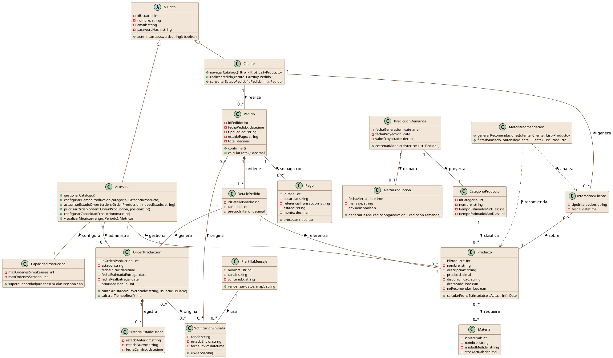

---

## Componente 8. Diagrama de estados por cada clase

Se documentan las tres clases con comportamiento relevante por estados: `OrdenProduccion` (núcleo del sistema), `Pedido` y `NotificacionEnviada`.

### 8.1. Orden de producción

Código fuente: [`docs/diagrams/08_estados_orden_produccion.puml`](docs/diagrams/08_estados_orden_produccion.puml)

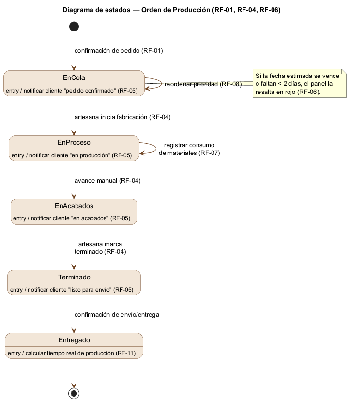

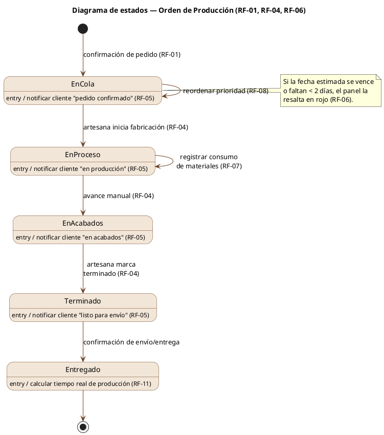

### 8.2. Pedido

Código fuente: [`docs/diagrams/08_estados_pedido.puml`](docs/diagrams/08_estados_pedido.puml)

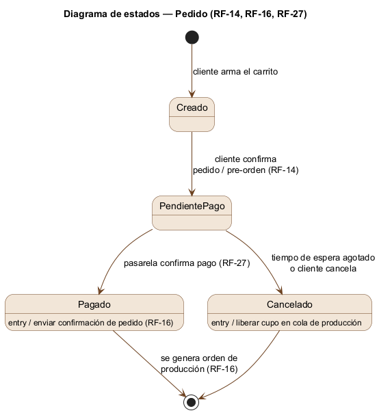

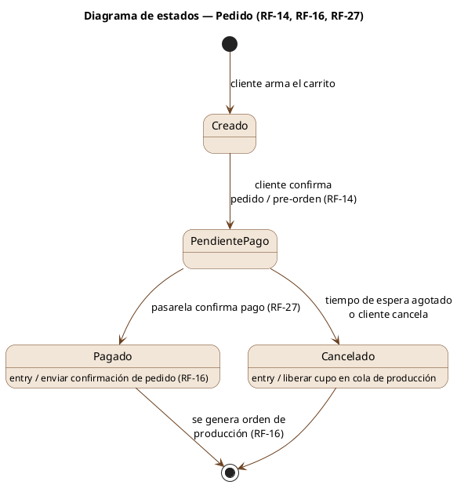

### 8.3. Notificación enviada

Código fuente: [`docs/diagrams/08_estados_notificacion.puml`](docs/diagrams/08_estados_notificacion.puml)

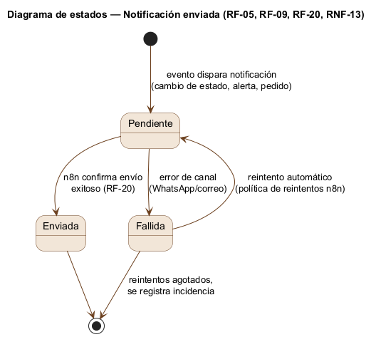

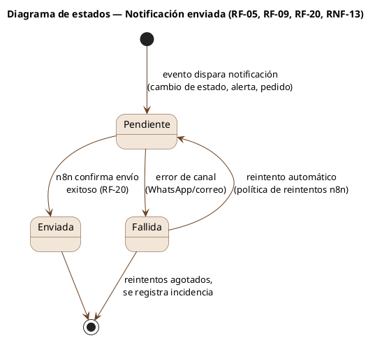

---

## Componente 9. Diagrama de colaboración por proceso

### 9.1. Proceso: Realizar pedido y generar orden de producción

Código fuente: [`docs/diagrams/09_colaboracion_proceso_pedido.puml`](docs/diagrams/09_colaboracion_proceso_pedido.puml)

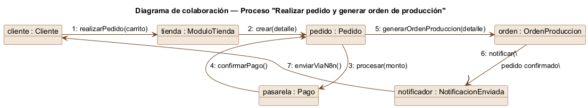

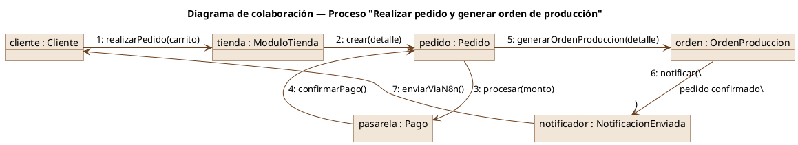

### 9.2. Proceso: Generar alerta proactiva de producción desde la predicción de demanda

Código fuente: [`docs/diagrams/09_colaboracion_proceso_alerta_demanda.puml`](docs/diagrams/09_colaboracion_proceso_alerta_demanda.puml)

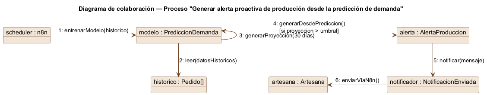

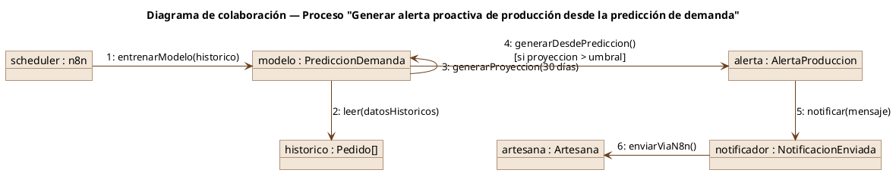

---

## Componente 10. Diagrama de secuencia por proceso

### 10.1. Proceso: Realizar pedido y generar orden de producción

Código fuente: [`docs/diagrams/10_secuencia_proceso_pedido.puml`](docs/diagrams/10_secuencia_proceso_pedido.puml)

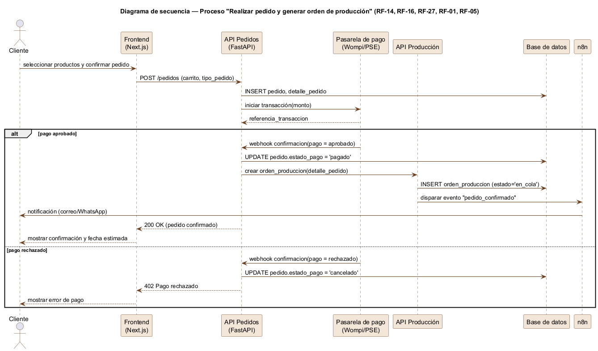

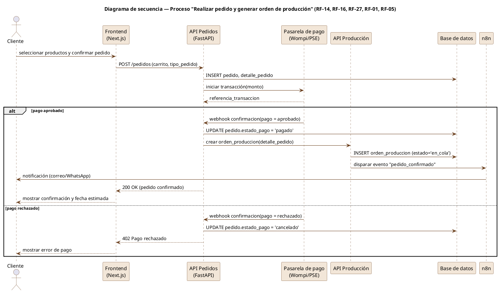

### 10.2. Proceso: Generar alerta proactiva de producción

Código fuente: [`docs/diagrams/10_secuencia_proceso_alerta_demanda.puml`](docs/diagrams/10_secuencia_proceso_alerta_demanda.puml)

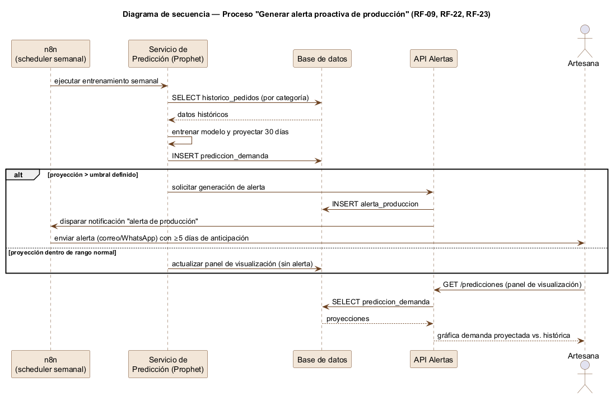

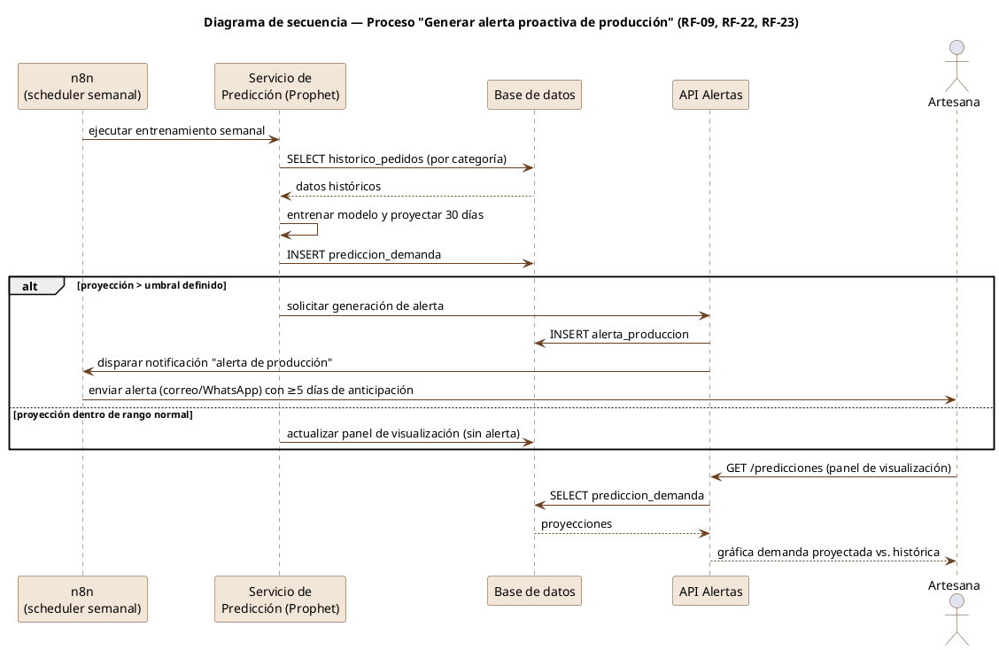

---

## Componente 11. Diagrama de componentes

Muestra los componentes de software de la plataforma (frontend, APIs del backend, módulos de IA, base de datos) y sus dependencias con los sistemas externos (n8n, Wompi, WhatsApp Business API).

Código fuente: [`docs/diagrams/11_diagrama_componentes.puml`](docs/diagrams/11_diagrama_componentes.puml)

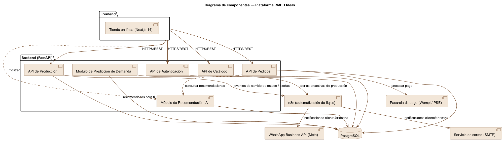

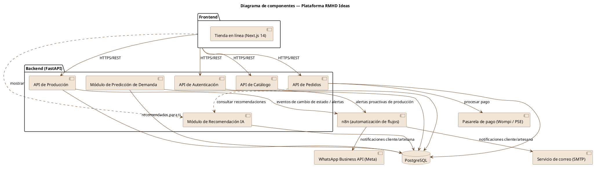

---

## Componente 12. Diagrama de distribución

Representa el despliegue físico/lógico: dispositivos del cliente y la artesana, el contenedor de Railway.app (frontend + backend + PostgreSQL) y los servicios en la nube externos (n8n Cloud, Wompi/PSE, WhatsApp Business API, proveedor de IA).

Código fuente: [`docs/diagrams/12_diagrama_distribucion.puml`](docs/diagrams/12_diagrama_distribucion.puml)

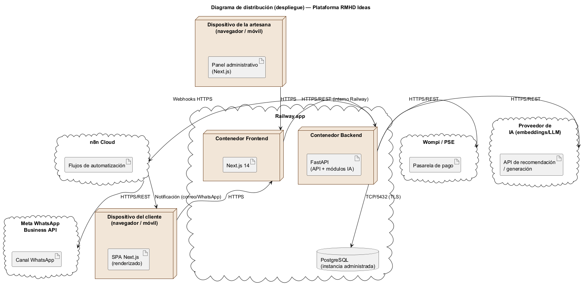

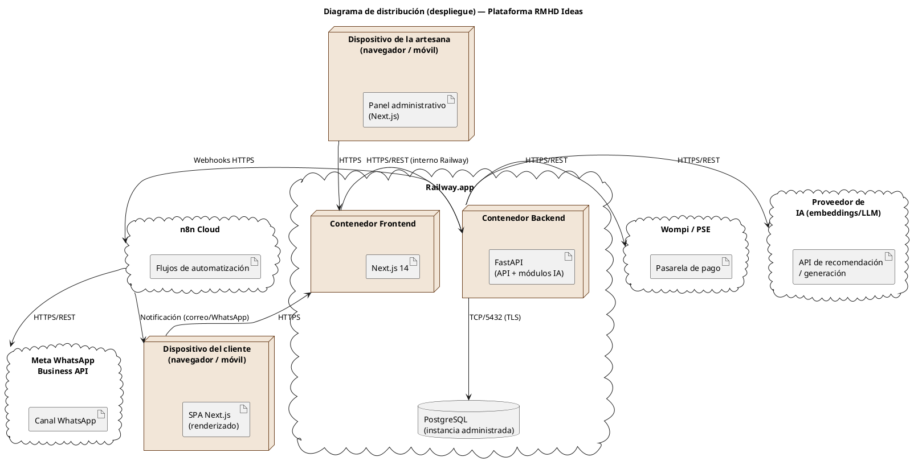

---

## Estructura de este repositorio

```
.
├── README.md                              # Este manual técnico completo
└── docs/
    ├── diagrams/
    │   ├── 03_modelo_relacional.puml
    │   ├── 06a_casos_uso_alto_nivel.puml
    │   ├── 07_diagrama_clases.puml
    │   ├── 08_estados_orden_produccion.puml
    │   ├── 08_estados_pedido.puml
    │   ├── 08_estados_notificacion.puml
    │   ├── 09_colaboracion_proceso_pedido.puml
    │   ├── 09_colaboracion_proceso_alerta_demanda.puml
    │   ├── 10_secuencia_proceso_pedido.puml
    │   ├── 10_secuencia_proceso_alerta_demanda.puml
    │   ├── 11_diagrama_componentes.puml
    │   ├── 12_diagrama_distribucion.puml
    │   └── png/                           # Renders PNG de cada diagrama
    └── database/
        └── script_bd_rmhd_ideas.sql
```

> **Nota:** este repositorio contiene únicamente la documentación del Manual Técnico (requerimientos, modelo de datos, diagramas UML y script SQL). No contiene código fuente de la aplicación (frontend/backend), que se gestiona en otro repositorio del proyecto.
